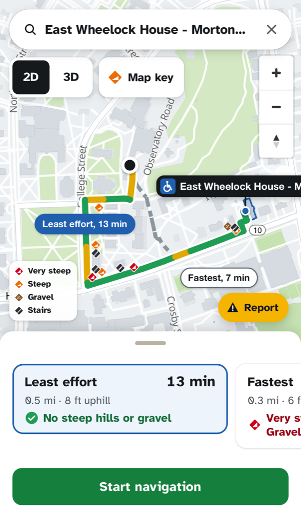

# Wheelio

**A campus navigator for wheelchair users.** From wherever you are on campus to any building, along the accessible route that takes the least physical effort, ending at an accessible entrance.

<p align="center">
  
</p>

Built at the **AI at 70 Hackathon at Dartmouth** (October 30 to 31, 2026) by Aditya Tripathi and Caleb Zhou.

> Wheelio is a student project. It is not affiliated with or endorsed by Dartmouth College.

---

## The problem

Dartmouth sits on a hill. For a student in a manual wheelchair, the shortest path between two buildings can mean a very steep climb, a gravel shortcut, or a flight of stairs with no warning until you reach it.

- Dartmouth's accessible shuttle (MobiliD) runs Monday to Friday, 7 a.m. to 7 p.m. Evenings and weekends, students wheel the whole way.
- Existing tools don't solve it. Google Maps has wheelchair routes for transit, not campus paths. Dartmouth's accessibility map is static and color-coded. None of them rank routes by how tiring they are, route to the accessible door, or update when a ramp is blocked today.

## What it does

- **Start anywhere.** Use your phone's location, tap the map, or pick a building. If you start off the path network (a parking lot, a lawn), Wheelio snaps you to the nearest path and tells you how far away it is.
- **Go to any building.** Search by name or nickname. The route ends at that building's accessible entrance, not its front door.
- **Two routes, you choose.** The **least effort** route (avoids hills, gravel and stairs) is shown next to the **fastest** accessible route, with the tradeoff in plain words: "6 min longer, avoids a very steep hill."
- **Hazards you can see.** Stairs, steep and very steep hills (with uphill arrows), gravel and brick are always drawn and labeled on the map. The route itself is colored by difficulty, with a colorblind mode that adds line patterns.
- **Plain language.** Users see "gentle", "moderate", "steep" and "very steep", not grade percentages. Exact numbers sit in an optional details view.
- **Live navigation.** Follows your location, counts down time left, warns "Steep stretch in 200 ft", reroutes if you go off course, and tells you when you've reached the accessible entrance.
- **Barrier reports.** Take a photo of a blocked ramp or construction fence. AI checks the photo, the report is pinned to the path it affects, and routes adapt for everyone, cautiously (see the trust rules below).
- **Facilities fix list.** Facilities staff get a prioritized list of confirmed barriers with photos, and can mark each one confirmed, not a barrier, or fixed.
- **Works as a phone app.** A mobile-first web app with a draggable bottom sheet, 44 px touch targets, and "Add to Home Screen" support.

## How it works

### 1. The path network
Dartmouth publishes its accessible "Path of Travel" map as a public ArcGIS service: about 2,700 path segments, each with a surface (concrete, pavement, brick, gravel, stairs, crosswalk) and a coarse slope class. `scripts/build_graph.py` joins those segments into a routable graph, splits lines where one path meets the middle of another, and fills a few gaps with paved OpenStreetMap sidewalks and hand-checked additions. The result is about 2,650 edges, 99% of them in one connected network. Each of the 217 accessible entrances is snapped onto the network.

### 2. Elevation
Dartmouth's slope classes are too coarse ("under 5", "over 5", "over 10") and say nothing about direction. `scripts/add_elevation.py` samples the USGS 1 meter lidar elevation model every 5 m along every path and stores, for each direction: the steepest uphill stretch (a best-fit line over 15 m, to smooth out lidar noise), the total climb, and the full elevation profile. Where lidar is unreliable (bridges and decks, which bare-earth lidar removes), it falls back to Dartmouth's label.

### 3. The effort model
Routes are ranked by physical effort, measured in "flat-meters" (1 unit = pushing 1 m on flat concrete):

```
effort = length x surface x grade x label  (+ about 15 m per crosswalk)

grade (uphill g %)    = 1 + 0.16 x g     about 3x the effort at a 12.5% slope
grade (downhill g %)  = 1 + 0.05 x g     braking and control
surface               concrete, pavement, crosswalk 1.0 | brick 1.2 | gravel 1.5 | stairs: never used
```

The coefficients are **our own estimates**, anchored in published research summarized by the SCIRE Project: push force rose about 200% at a 1:8 slope (Gagnon 2014), the share of users keeping normal speed dropped sharply between 3.6 and 7.1 degrees (Gagnon 2015), and soft surfaces raised push forces 18 to 130% (Nagy 2012). The app says so.

Any stretch steeper than the user's limit is avoided (default 8.33%, the steepest a standard ramp allows). If there is no way around a hill, Wheelio returns the gentlest route that exists and says so plainly. There are three profiles: manual chair, power chair, and walker or crutches. A route search (Dijkstra over the graph, run twice for least effort and fastest) takes about 10 to 25 ms.

### 4. Where AI fits
Wheelio uses Claude (Anthropic's API) for three jobs. **The routing math is plain, deterministic code. AI never picks a route.**

- **Photo check:** classifies a barrier photo (type, severity, passable or not for a manual chair, confidence). It is told to ignore people and any text in the photo.
- **Route briefing:** one or two plain sentences about what to expect ("One moderate slope near Dartmouth Hall, then flat to the side entrance"). Code computes the facts; Claude only words them, and a filter rejects percentages and jargon.
- **Facilities fix list:** code orders the confirmed barriers; Claude drafts the summary, labeled "Draft by AI, check before acting."

Every AI feature has a non-AI fallback, so the app works with no API key, a slow network, or a refused request.

### 5. Barrier reports: who can report, and how fake ones are handled
A fake report costs someone a detour. A missed real barrier can strand someone. So reports only ever add caution, and the user always sees an alternative.

- **Anyone** can report without an account. It shows as "Reported, unconfirmed", adds a small penalty and a warning, and never blocks a path on its own.
- **A signed-in student** confirms it: one signed-in report with a confident photo check, or one signed-in "Still there? Yes", blocks the path temporarily. Three independent reports also confirm it.
- **Facilities staff** reports count as verified right away and stay until staff mark them fixed.
- When the photo check is unsure, the report goes to "needs a person to confirm" and changes no routes until someone does.
- Photos come from the live camera only (no gallery uploads), within about 30 m of the path. Reports expire after 12 hours (48 hours for construction), are rate-limited, and duplicate photos are rejected.

The demo uses a clearly labeled "Demo sign-in" screen with sample accounts and no passwords. A real version would use the university's single sign-on.

## Safeguards

- **The user chooses.** Wheelio always shows an alternative route and the tradeoff; it never decides for you.
- **No disclosure required.** Anyone can get a route without an account or saying anything about a disability. Profiles are just settings.
- **Location privacy.** Your location is used only to compute the route. It is never stored or logged, and trips are never saved.
- **Honest about limits.** Effort coefficients are labeled as estimates. Starting far from a path triggers a warning. Dartmouth's "No bueno" path label, whose meaning we don't know, is treated as a penalty, never a block, and the app says so.
- **Photos.** The app asks users to keep faces out of photos, the photo check ignores people, and location data (EXIF) is stripped from uploaded photos.

## Run it

Requires Python 3.12 and [uv](https://docs.astral.sh/uv/).

```bash
git clone <this repo>
cd Wheelio
cp .env.example .env          # optional: add ANTHROPIC_API_KEY for the AI features
uv sync
uv run uvicorn backend.app.main:app --reload --port 8000
```

Open http://localhost:8000. Without an API key, everything still runs; AI features use their fallbacks.

Useful URLs:
- `/?start=43.7048477,-72.2866011&to=bldg:east-wheelock-house-morton-hall` opens a sample trip where the fastest route climbs a very steep hill and the least effort route goes around it.
- `/?demo=1` adds buttons that replay a trip at high speed (with and without a wrong turn) for testing navigation on a laptop.
- `/?mock=1` runs the frontend on fixture data, without the backend.

**On a phone:** phone browsers only share your location over HTTPS. `scripts/phone.sh` starts the app and opens a temporary HTTPS tunnel, then prints a link to open on your phone. Anyone with the link can reach the app while it runs, so stop it when you're done.

**Checks:** start a fresh server in dev mode (`WHEELIO_DEV=1 uv run uvicorn backend.app.main:app --port 8000`), then `uv run python scripts/check_mvp.py` runs end-to-end checks over every endpoint and edge case.

## Rebuilding the data

The processed graph and map layers are committed, so you only need this to refresh the data:

```bash
uv run python scripts/fetch_data.py        # Dartmouth accessibility layers -> data/raw/
uv run python scripts/build_graph.py       # path graph -> data/processed/graph.json
uv run python scripts/add_elevation.py     # downloads the 67 MB USGS lidar tile once, adds grades
uv run python scripts/build_map_layers.py  # hazards, network, labels -> frontend/data/
```

`scripts/preview.py` draws the graph, grades or a test route on a standalone HTML map, and `scripts/find_demo_routes.py` ranks start and destination pairs where the fastest and least effort routes differ the most.

## Project layout

```
backend/app/
  main.py          FastAPI app; serves the API and the frontend
  routing/         graph loading and snapping, effort model, route search
  routers/         HTTP endpoints: places, route, reports, sign-in and facilities
  barriers.py      barrier report store, trust rules, expiry, routing penalties
  auth.py          demo sign-in and rate limits
  ai/              photo check, route briefing, facilities fix list
frontend/          MapLibre GL map, bottom sheet, navigation, reports (plain JS, no build step)
scripts/           data download, graph building, elevation, previews, checks
data/              raw source layers and the processed graph
docs/api.md        API contract
```

**Stack:** Python, FastAPI, NetworkX, Shapely, rasterio, NumPy; MapLibre GL JS with OpenFreeMap vector tiles; Claude API.

## Data and credits

- **Paths, accessible entrances, accessible parking, buildings, bus stops:** Dartmouth's public "Path of Travel" accessibility map (ArcGIS). We don't own this data; the copies in `data/raw/` were downloaded from the public service.
- **Elevation:** USGS 3D Elevation Program, 1 meter lidar (public domain).
- **Gap-filling sidewalks:** © OpenStreetMap contributors, available under the Open Database License.
- **Base map:** © OpenMapTiles, Data from OpenStreetMap, served by OpenFreeMap. Map rendering by MapLibre GL JS.
- **Research behind the effort model:** SCIRE Project review of wheelchair propulsion on non-level surfaces (Gagnon 2014 and 2015, Richter 2007, Pierret 2014, Nagy 2012).

## What's next

A native iOS and Android app, real university sign-in, awareness of MobiliD hours (offering a ride when a route is very tiring), benches as rest stops, a snow mode for cleared paths, and a second campus.

## License

[MIT](LICENSE) © 2026 Aditya Tripathi and Caleb Zhou. The license covers our code. The data sources above keep their own terms.
